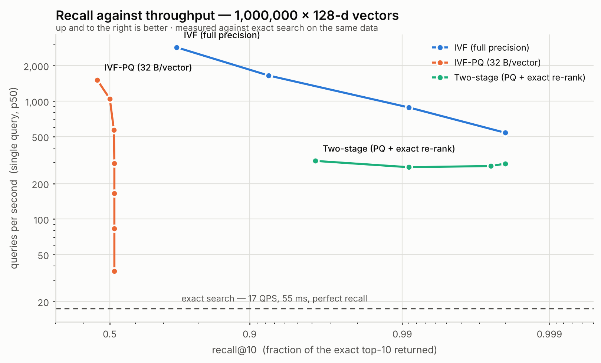
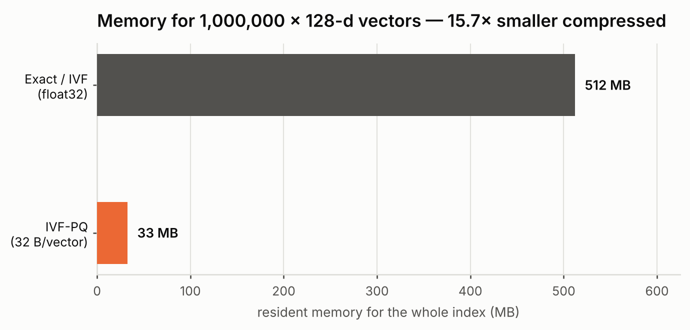

# nanosearch

**A vector search engine built from scratch — IVF-PQ approximate nearest
neighbour indexing, exact re-ranking, and a REST service. NumPy only.**

[](https://github.com/YOUR-GITHUB-USERNAME/nanosearch/actions/workflows/ci.yml)


Every retrieval-augmented system, semantic search box and recommendation feed
rests on the same primitive: find the `k` nearest vectors to this one, out of
millions, in a few milliseconds, without keeping every vector in RAM. This is
that primitive, built up from first principles — k-means, inverted indexes,
product quantisation and a disk-backed re-ranking stage — with every claim
measured against exact search on the same data.

The index core depends on **NumPy and nothing else**.

---

## Results

One million 128-dimensional vectors, `nlist=1024`, PQ `m=32`, single-query
latency, 2-core container. Recall is measured against exact search on the same
data; queries are held out of the database.

| Index | recall@10 | p50 | p95 | QPS | vs exact | RAM |
|---|---|---|---|---|---|---|
| Exact (brute force) | 1.000 | 55.4 ms | 74.6 ms | 17 | 1× | 512 MB |
| IVF, `nprobe=2` | 0.924 | 0.53 ms | 1.15 ms | 1 647 | **105×** | 512 MB |
| IVF, `nprobe=4` | 0.991 | 1.06 ms | 2.06 ms | 883 | **52×** | 512 MB |
| IVF, `nprobe=8` | 0.998 | 1.83 ms | 3.12 ms | 539 | 30× | 512 MB |
| IVF-PQ, `nprobe=4` | 0.517 † | 1.71 ms | 2.98 ms | 571 | 32× | **32.7 MB** |
| **Two-stage** (IVF-PQ + exact re-rank), `factor=32` | **0.9975** | 3.38 ms | 5.88 ms | 282 | **16×** | **32.7 MB** |

† 0.968 of the true top-10 land inside IVF-PQ's 100-item shortlist. The gap
between those two numbers is the most interesting result in the project, and
[section 5 of the design notes](docs/DESIGN.md#5-what-pq-actually-costs--and-the-two-stage-fix)
is about why.

**Two headline trade-offs.** Give up 0.9% of recall and queries get **52×
faster**. Give up **15.7× of memory** and recall still lands at **0.9975** —
because the compressed index is used as a candidate generator, and a few
hundred of its candidates are re-scored exactly against vectors streamed from
disk.

<picture>
  <source media="(prefers-color-scheme: dark)" srcset="docs/bench/recall_vs_qps_dark.png">
  
</picture>

<picture>
  <source media="(prefers-color-scheme: dark)" srcset="docs/bench/memory_dark.png">
  
</picture>

Raw output: [`docs/bench/`](docs/bench). Reproduce with `make bench-big`.

---

## Quickstart

```bash
git clone https://github.com/YOUR-GITHUB-USERNAME/nanosearch.git
cd nanosearch
pip install -e ".[service,bench,dev]"

make demo     # guided tour: text search, then the index trade-offs
make serve    # REST service + browser demo at http://127.0.0.1:8000
make check    # lint, type check, 191 tests
```

### As a library

```python
import numpy as np
from nanosearch import IVFPQIndex, RefineIndex

vectors = np.load("embeddings.npy")  # (1_000_000, 128) float32

index = IVFPQIndex(dim=128, nlist=1024, m=32, metric="cosine")
index.train(vectors)  # learn the partition + codebooks
index.add(vectors)  # 32 bytes per vector, not 512

ids, scores = index.search(query, k=10, nprobe=8)

# Two-stage: compressed shortlist in RAM, exact re-rank from disk.
engine = RefineIndex(index.clone_trained(), path="vectors.f32", factor=32)
engine.add(vectors)
ids, scores = engine.search(query, k=10, nprobe=8)  # recall@10 ≈ 0.998
```

### As a text search engine

```python
from nanosearch.engine import SearchEngine

engine = SearchEngine.build(["first document", "second document", ...])
for hit in engine.search("a natural language query", k=5):
    print(hit.score, hit.text)
```

`SearchEngine.build` picks the index for you from the corpus size — exact
search below 10k vectors, IVF to 50k, IVF-PQ above. Bring your own vectors, the
built-in NumPy TF-IDF/SVD embedder, or a transformer:

```python
from nanosearch.text import SentenceTransformerEmbedder

engine = SearchEngine.build(texts, embedder=SentenceTransformerEmbedder())
```

### From the command line

```bash
nanosearch build corpus.jsonl --out ./index
nanosearch search ./index "why is my database query slow" -k 5
nanosearch stats ./index
nanosearch serve ./index
```

### As a service

```bash
docker build -t nanosearch . && docker run -p 8000:8000 nanosearch
curl -X POST localhost:8000/search -H 'Content-Type: application/json' \
     -d '{"query": "how do neural networks learn", "k": 5}'
```

| Endpoint | Purpose |
|---|---|
| `GET /` | browser demo |
| `GET /healthz` | readiness, answered from memory without touching the index |
| `GET /stats` | index internals and observed p50/p95/p99 |
| `POST /search` | `{query, k, nprobe}` → ranked results with server-side timing |
| `POST /documents` | add documents using the embedder as fitted |
| `GET /docs` | generated OpenAPI page |

---

## How it works

Exact search costs `O(n·d)` per query and keeps every vector resident. Those
are two separate problems, and they need two different ideas.

**1. IVF — score fewer vectors.** k-means partitions the space into `nlist`
cells once, at build time. A query scores only the `nprobe` cells whose
centroids are nearest to it, which is about `nprobe/nlist` of the corpus. The
approximation is exactly one thing: a true neighbour in a cell that was not
probed cannot be returned. So `nprobe` is a *runtime* recall dial on an
already-built index, and `nprobe = nlist` reduces to exact search — which the
test suite asserts, because if it did not hold, vectors would be going missing
somewhere.

**2. PQ — make each vector smaller.** Split each vector into `m` slices and
k-means each slice independently into 256 centroids. A vector becomes `m`
bytes, and the codebooks jointly describe `256^m` points. Distances are then
computed by *table lookup* rather than arithmetic: precompute each query's
distance to all 256 centroids per slice, and scoring a candidate becomes `m`
byte-indexed lookups. PQ is applied to `x − centroid(x)` rather than `x`, which
resolves the residual far more finely at identical cost.

**3. Exact re-ranking — buy the accuracy back.** PQ's recall ceiling is set by
`m`, not by `nprobe`: the codes find the right neighbourhood and cannot order
it finely. So the compressed index generates `k × factor` candidates and those
few hundred are re-scored against full-precision vectors held in a `np.memmap`
file — the OS pages in only the rows touched. RAM holds the codes; the cold
bytes stay on disk.

Everything reduces to one distance function and one selection primitive, so the
backends differ only in *which* candidates they score. Cosine needs no separate
code path: for unit vectors `‖q−x‖² = 2 − 2cos(q,x)`, so ranking by either is
the same ranking.

**[→ Full design notes](docs/DESIGN.md)** — the maths, the data structures, two
optimisations found by profiling, a parameter guide, and an explicit list of
what this does not do.

---

## Repository layout

```
nanosearch/
├── metrics.py      distance expansion, O(n) top-k selection
├── kmeans.py       k-means++ and Lloyd iterations
├── flat.py         exact search — the baseline recall is measured against
├── inverted.py     inverted lists, CSR-packed on save
├── ivf.py          partitioned index
├── pq.py           product quantiser, ADC lookup tables
├── ivfpq.py        residual-encoded IVF-PQ
├── refine.py       two-stage retrieval over a memmap
├── text.py         TF-IDF + randomized SVD, hand-rolled CSR
├── engine.py       embedder + index + document store
├── evaluate.py     recall@k, latency percentiles
└── service/        FastAPI app, schemas, browser demo
benchmarks/         sweeps, data generators, charts
tests/              191 tests
docs/DESIGN.md      design notes
```

## Engineering notes

- **Measured, not asserted.** Every number in this README comes from
  `benchmarks/`, with exact search as ground truth and queries held out of the
  database. Raw JSON and logs are committed.
- **Benchmarked on realistic geometry.** Synthetic vectors are generated with a
  power-law covariance spectrum and overlapping clusters, because isotropic
  Gaussian noise has no neighbourhood structure to find and makes any index
  look good. `--data mine.npy` runs the same harness on real embeddings.
- **Tail latency, not averages.** p50/p95/p99, measured one query at a time,
  which is how a service is actually hit.
- **Bounded memory everywhere.** Blocked distance matrices, chunked encoding,
  geometric array growth, subsampled k-means training.
- **No pickles.** Indexes save as `.npz` plus a JSON sidecar, so loading one
  someone else built cannot execute their code. `allow_pickle=False` is
  asserted in the tests.
- **Fast paths checked against readable ones.** The batched-matmul distance
  table builder is asserted equal to the obvious loop it replaced.

## What's missing

No HNSW, no OPQ, no SIMD lookup kernels, no deletion, no concurrency control,
no metadata filtering. Each is explained — with why it matters and what it
would take — in [§11 of the design notes](docs/DESIGN.md#11-what-this-does-not-do).

## References

Jégou, Douze & Schmid (2011), *Product Quantization for Nearest Neighbor
Search* · Ge et al. (2013), *Optimized Product Quantization* · Malkov &
Yashunin (2018), *HNSW* · Halko, Martinsson & Tropp (2011), *Finding Structure
with Randomness* · Arthur & Vassilvitskii (2007), *k-means++*

## License

MIT
